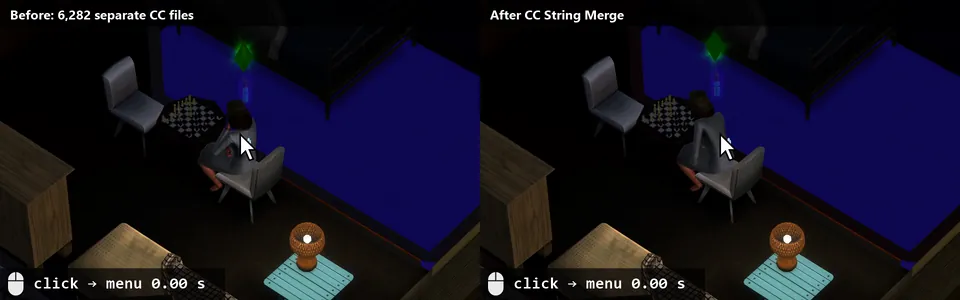

# CC String Merge

A SmellyMods tool by SmellyBelly.

Faster Sim menus in **The Sims 3** when you have a lot of custom content.

Every CC object brings its own string tables, usually 23 of them (one per language). With a few thousand objects the
game holds tens of thousands of tiny tables, and every name lookup gets slower. The Sim's pie menu sorts its entries
by name and does thousands of those lookups per click, so clicking a Sim takes a noticeable moment.

CC String Merge moves all those strings into **one table per language**. The game finds strings by their key, not by
the table they are in, so no text changes in game.



*Clicking your own Sim, before and after (with the default strings package). The timer runs from the mouse press
until the menu is on screen, so it is a little higher than the measured times below.*

Download, how-to and updates: [sims3.smellybelly.de](https://sims3.smellybelly.de/mods/cc-string-merge/).

## Measured

One PC, one save, 6,282 CC packages from ATS3 and MTS (3.4 GB, about 150,000 string tables), each setup started
two or three times. Times are wall-clock; the pie menu is the active Sim's own menu.

| | Separate files (no tool) | Strings package (default) | Merge mode (`--merge`) |
|---|---|---|---|
| Sim's pie menu | 590-633 ms | 135-138 ms | 102 ms |
| One string lookup | 52 µs | 0.7 µs | 0.7 µs |
| Game start to main menu | 106-108 s | 78 s | 29 s |
| Load the save (click to loading screen gone) | 219-225 s | 194 s | 29-31 s |
| Game memory (virtual, peak) | 2.7 GB | 2.5 GB | 2.5-2.8 GB |
| Files in Mods | 6,282 | 6,283 | 13 |

Every string was still found in all three setups (3,000 sampled), and undo gave back all 6,282 files byte for byte.

**Is merge mode worth it?** The strings package already fixes the slow menu. Merge mode fixes loading: with
thousands of CC files it cut loading the save from over three minutes to half a minute, and the main menu came up
almost four times sooner. The cost: you can no longer remove one item by deleting its file (undo the run, delete
the file, run the tool again). With a few hundred CC files the default is enough; with thousands, merge mode saves
minutes on every start.

## How to use it

1. Close The Sims 3. The tool refuses to run while the game is open.
2. Download `CCStringMerge.exe` and check its SHA-256 against `SHA256SUMS.txt` on the release page.
3. Double-click it. It uses `Documents\Electronic Arts\The Sims 3\Mods\Packages`. Or drop any folder of CC onto it.
4. It shows what it would change. Type `Y` and press Enter to go ahead.

It does this:

- Takes the string tables out of every CC package and writes them into one `CCStringMerge_Strings.package` in that
  folder. Every other resource is copied byte for byte, and your files keep their names and folders, so you can
  still remove one item by deleting its file.
- Moves the originals into a backup folder **outside Mods** (`The Sims 3\CCStringMerge backups\<date>`), so the
  game never loads them twice. Nothing is deleted.
- Checks every resource and every string against the backup afterwards. On any mismatch it puts everything back by
  itself.

**New CC later?** It works right away, just without the speed-up. Run the tool again and it adds the new strings to
the strings package.

**Removed CC?** Its strings stay in the strings package. That does no harm.

### Merge mode

`CCStringMerge.exe --merge` also merges all CC packages into a few big `CCStringMerge_Merged_NNN.package` files
(1 GB each; change it with `--part-size <MB>`). The game then has fewer files to open too, but you can no longer
remove one item by deleting its file. If two packages hold the same resource, the first one in name order is kept,
and the report lists every case.

### What it leaves alone

- Script mods (packages with a `.dll` assembly inside, such as NRaas), packages from other games, and anything that
  does not read cleanly. The report lists each one and the reason.
- `.sims3pack` files and the launcher's `DCCache`: only `.package` files in the folder you give it are read.

## Undo

Drop the run's backup folder (`The Sims 3\CCStringMerge backups\<date>`) onto `CCStringMerge.exe`, or run
`CCStringMerge.exe --undo "<that folder>"`. Undo newer runs before older ones.

Before changing anything, the undo checks that the files it wrote are still unchanged. If you edited or replaced one
since then, it stops and changes nothing. With `--force` it moves those files to `<backup>\changed-since` and undoes
anyway. If you deleted a CC file since then, the undo doesn't bring it back; its original stays in the backup.

## All options

```
CCStringMerge.exe [folder] [--merge] [--part-size MB] [--dry-run] [--undo RUN_FOLDER] [--force] [--yes]
```

`--dry-run` shows the report and changes nothing. `--yes` skips the question and the "press Enter" at the end.

## Windows warnings

The exe is not code-signed. Windows SmartScreen may say "Windows protected your PC": click *More info*, then
*Run anyway*. Some antivirus programs flag every PyInstaller exe at first. If you prefer, run the source instead
(`python ccstringmerge.py`, Python 3.8 or newer, no other packages needed).

## Please link, don't re-upload

Share the link to this page instead of uploading the exe elsewhere. That way everyone gets fixes and can check the
checksum.

## Support

If it made your Sims faster, you can leave a tip on [Ko-fi](https://ko-fi.com/smellybelly). Never required, the tool
stays free.

## Licence

MIT, see [LICENSE](LICENSE). Not made by or affiliated with Electronic Arts. The Sims is a trademark of Electronic
Arts Inc.

## Building

```
python -m venv .venv
.venv\Scripts\python -m pip install pyinstaller
powershell -File build.ps1
```

`build.ps1` runs the tests (`python -m unittest discover -s tests`), builds `dist\CCStringMerge.exe` and writes
`dist\SHA256SUMS.txt`.
